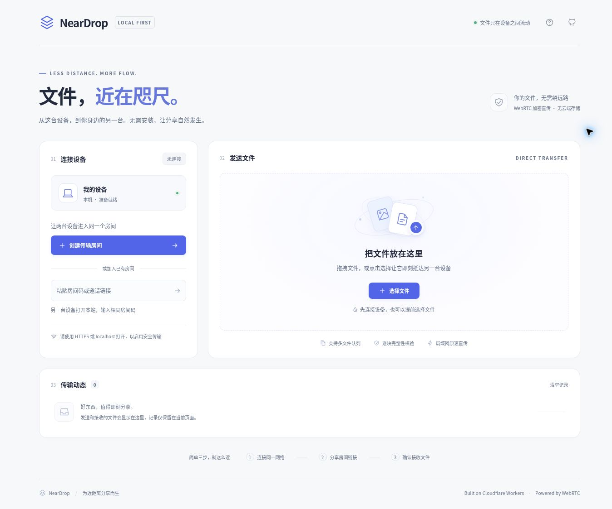

# NearDrop · Workers P2P

**文件，近在咫尺。** 一个为局域网分享设计的轻量文件传输网站，部署在 Cloudflare Workers。浅色响应式界面，支持手机、平板和桌面端；不需要安装客户端。



## 工作方式

1. 两台设备接入同一局域网，联网打开网站。
2. 一台设备创建房间，把邀请链接或房间码发给另一台。
3. 选择 / 拖入文件，接收方确认保存，开始设备直传。

**文件字节、文件名、文件大小均通过 WebRTC DataChannel 在设备间传送，不上传 Worker。** Worker + Durable Object 只托管静态页面并交换连接状态、SDP / ICE 信令。默认使用 Cloudflare 公共 STUN 辅助发现可达地址，不提供 TURN / HTTP 文件中继。STUN 只交换连接探测数据，文件仍在设备之间直传。

## 功能与可靠性

- 6 位数字房间码（例如 `381529`），由服务器原子预留、避免撞号；每个房间限两台设备，每个文件手动确认接收。房间码有效期 1 小时。
- 双向发送，最多 100 个待发文件，按队列逐一处理；同一时间一个传输会话。
- 64 KiB 数据帧、1 MiB 校验块、最多 8 MiB 在途窗口。连续发送多个分块，避免每块都等一个确认往返；确认进度仍以 SHA-256 校验且写入成功为准。读取和散列预取一个分块，与发送背压等待重叠。
- 发送缓冲背压、确认超时、异常长度 / 顺序检查，阻止无界缓冲。
- 首次配对由服务器统一指定协商方，直接启动 WebRTC；每轮连接有独立会话 ID，旧 SDP / ICE 不会串入新连接。移除候选池预分配，使用 STUN 辅助，并在 ICE 首次失败时自动重试一次。
- WebSocket 自动重连；已建立的直连可独立于短暂信令故障继续运行。
- 保留页面的断线续传：重连后由接收端报告**已校验且写入**的偏移，发送方点击「继续传输」。丢失分块或最终确认也不会重复保存文件。
- 所有设备仍使用「接收文件」。小文件直接下载；大文件自动分块写入浏览器本地临时文件，完成后点「保存文件」，**Firefox 不再因为缺少系统保存选择器而被卡在 128 MiB**。
- 可选的「直接保存到磁盘」仍供支持该接口的浏览器使用。无论选择哪条路径，文件不经过服务器。
- 临时文件优先使用浏览器 OPFS 写入；缺少异步写接口时，通过专用 Worker 使用同步文件句柄兼容较旧实现。程序不会为大文件建立整份内存 Blob。
- 128 MiB 只是从内存下载切换到本地临时文件的阈值，不是支持 OPFS 浏览器的文件大小上限。实际可接收大小取决于磁盘空间、浏览器站点存储配额和存储权限。隐私模式、禁用站点存储或配额不足会显示具体存储错误，允许重试。
- 临时文件下载链接不计入内存 Blob 保留额度；清空对应的已完成记录会撤销链接并释放临时文件。请先保存文件。离开的页面可能来不及清理，后续访问会清理本应用超过 7 天的临时会话，保留其他标签页及其他站点数据。
- 实时进度、确认后的速度、文件队列、取消 / 拒收、设备唤醒请求、关闭页面提醒。
- Hibernation WebSocket、SQLite Durable Objects、同源检查、信令尺寸 / 频率限制、CSP / 安全响应头。默认关闭 Worker 可观测性日志。
- 无运行时前端依赖、无外部字体、无 CDN 脚本、无分析追踪。

## 部署到 Cloudflare Workers

使用 Node.js **24**。依赖锁定在 `package-lock.json`，使用 `npm ci` 安装。

### 方式一：本机 Wrangler

```bash
git clone https://github.com/Tea1me/Workers_P2P.git
cd Workers_P2P
npm ci
npx wrangler login
npm run deploy
```

Wrangler 会部署静态资源和 Worker，自动创建 `ROOMS` Durable Object 命名空间。无需创建 KV、R2 或 D1；无需填写命名空间 ID。发布成功后终端会给出 `https://workers-p2p.<你的子域>.workers.dev` 地址。若账户内已有同名 Worker，请修改 `wrangler.jsonc` 的 `name`。

SQLite Durable Objects 支持 Workers Free 计划，但仍受 Cloudflare 当期额度限制；Workers 并不转发文件流量。可在 Cloudflare 控制台为该 Worker 绑定自定义域名，使用有效 HTTPS。

### 方式二：Cloudflare 控制台连接 GitHub

在 Workers & Pages 创建 **Worker（不是 Pages 项目）**，连接本仓库，选择当前默认分支。配置：

| 项目     | 值                               |
| -------- | -------------------------------- |
| 根目录   | `/`                              |
| 构建命令 | `npm run build`                  |
| 部署命令 | `npx wrangler deploy`            |
| Node.js  | `24`（可设置 `NODE_VERSION=24`） |

代码中已经包含 Durable Object 绑定和 SQLite 迁移。首次部署使用 `v1`；后续请保留已有迁移，勿删除命名空间或改类名来“解决”部署问题。

### 方式三：GitHub Actions

在仓库 Settings → Secrets and variables → Actions 添加：

- `CLOUDFLARE_API_TOKEN`：针对目标账户，包含 **Account / Workers Scripts / Edit** 权限。若使用自定义域名，可能需要相应 Zone 权限。
- `CLOUDFLARE_ACCOUNT_ID`：Cloudflare 账户 ID。

在 Actions → **Deploy to Cloudflare Workers** → Run workflow，选择目标分支。工作流会先测试，再部署。此流程使用手动触发；常规 push / PR 仅运行 CI 验证。

**不要把令牌提交到仓库或前端代码。** 应用本身不需要任何运行时密钥。

## 本地开发与验证

```bash
npm ci
npm run dev                   # http://localhost:3000，真实本地 Worker + DO
npm run check                 # 前端与 Worker 分别严格类型检查
npm test                      # 传输状态机和协议测试
npm run test:integration       # workerd / Miniflare 实际 WebSocket + DO 集成测试
npm run deploy:check          # 构建与 Wrangler 干运行，不部署
npx playwright install firefox chromium
npm run test:browser          # Firefox / Chromium 真实文件保存回归
```

开发命令也接受 `--host`、`--port`。启动时构建一次前端；修改前端后重新运行 `npm run build` 并刷新页面，Worker 源码由 Wrangler 监听。`localhost` 是浏览器认可的安全上下文。局域网其他设备直接打开普通 HTTP IP 地址时，安全上下文 API 可能不可用，请用正式 HTTPS 域名测试。

测试覆盖多块文件与零字节文件、拒收、字节损坏、块内断线、确认丢失、最终确认丢失、续传偏移、磁盘写入失败、流式保存、取消、房间容量、同设备重连、同源限制及信令数据校验。

### 发布后的验收建议

1. 在同一 Wi-Fi 的两台真实设备上互发小文件、图片和零字节文件。
2. 使用 Firefox、Chrome 或 Edge 接收超过 128 MiB 的文件，点击「保存文件」并对比 SHA-256；保存后清空记录，检查缓存释放。
3. 传输中断网再恢复，双方保持页面不刷新，重新连接后点击「继续传输」。
4. 检查拒收、取消、磁盘空间不足、第三台设备加入，以及移动端下载行为。
5. 根据自己的路由器、设备、浏览器测量速度。界面速度按接收确认字节计算，不以排入发送缓冲的字节冒充已传输。

## 边界与隐私

- **是局域网直传，不是完全离线应用。** 初次加载和配对需要互联网连接到 Cloudflare。不能用网页扫描整个局域网；通过房间凭证显式配对。
- 同一 SSID 不一定能互通：访客网络、AP / 客户端隔离、防火墙、VPN、不同网段或浏览器本地网络权限都可能阻止连接。失败会明确提示；不会自动上传文件。
- 不承诺固定传输速率或对任意浏览器无限大小。吞吐受网卡、Wi-Fi、磁盘、CPU、WebRTC 实现及接收端背压影响。千兆链路的标称速率不等于浏览器文件传输的实际速度；本项目没有百兆限速参数，也不承诺任意设备达到千兆线速。
- 续传信息仅存在当前页面内存 / 未提交的文件写入流。刷新、关闭、设备重启或浏览器回收后台页面会丢失进度。请保持页面前台、设备唤醒；不支持跨刷新续传。
- 6 位房间码是方便输入的短期配对凭证，不是强密码。1 小时后失效，已建立的直连可以继续传输；重建配对需要新房间。每个 IP 每分钟最多创建 20 次、尝试加入 60 次（共享公网 IP 会合计），超限明确提示。仍需仅向信任的设备分享，并在接收前核对文件。
- WebRTC 使用 DTLS 加密。SHA-256 用于传输完整性校验，不等于对文件安全性的扫描，也不等于独立身份认证。双方需信任站点部署者和配对信令；本项目没有额外的身份指纹比对。
- Cloudflare 能处理 IP、请求 URL 及 SDP / ICE 等连接元数据。房间标识会用于 WebSocket 请求路由；应用不记录文件内容，也不承诺平台层完全不产生访问日志。
- 接收到的文件一律以二进制下载，不自动预览或执行；文件名仅用 `textContent` 显示，下载名会清理路径和控制字符。

## 结构

```text
src/worker.ts             Worker 路由、安全头和配对 Durable Object
src/shared/protocol.ts    共享信令协议与房间码
src/client/connection.ts  WebSocket 重连 / WebRTC 连接 / 发送背压
src/client/transfer.ts    文件协议、校验、续传与保存状态机
src/client/receive.ts     自动接收、本地临时文件和可选保存位置
src/client/storage.ts     OPFS 临时文件、下载快照与清理
src/client/storage-worker.ts 兼容同步文件写入的专用 Worker
src/client/main.ts        界面、队列、接收确认和保存交互
src/client/style.css      响应式样式
index.html               应用界面
wrangler.jsonc           Cloudflare 部署配置
```

## 更新到 1.3

重新部署后，**双方都刷新页面**（页脚为 `NearDrop 1.3`），重新建一个 6 位数字房间。滑动窗口会协商对端接收能力；只更新一侧会保守回退到旧版逐块确认。Firefox 大文件接收不再需要 `showSaveFilePicker()`。

CI 包含真实 libwebrtc 多分块传输 / 重连，以及 Firefox / Chromium 的 256 MiB 以上文件接收、真实浏览器下载、整文件 SHA-256 对比和临时存储兼容路径验证。测试不替代你家中路由器、网卡和设备的实际测速。

若仍无法直连，页面会显示协商错误。STUN 可补充可达地址，但不能保证穿过访客 Wi-Fi 隔离、防火墙或 VPN；本项目不使用服务器文件中继。
